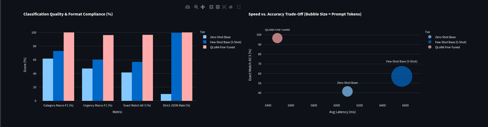
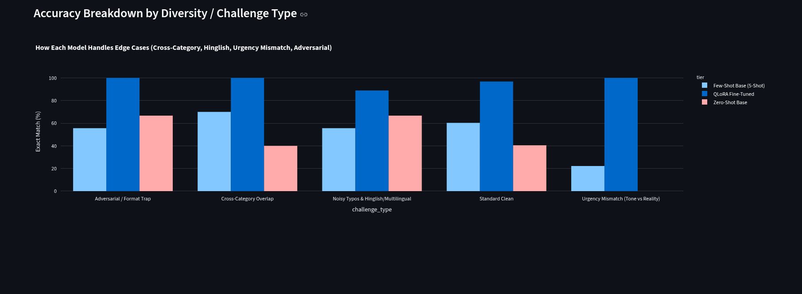
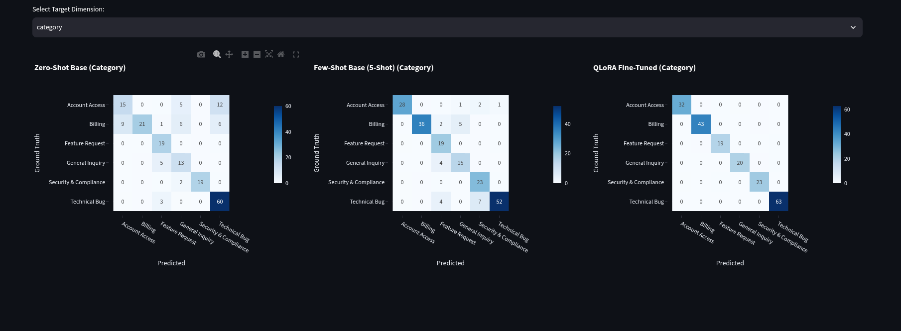

# 🎫 Open-Weight LLM Benchmark: Zero-Shot vs. Few-Shot vs. QLoRA Fine-Tuned

An end-to-end local evaluation pipeline and interactive Streamlit dashboard benchmarking **Meta's Llama 3.2 (3B) Instruct** across three deployment tiers—**Zero-Shot Base**, **Few-Shot Base (5-Shot)**, and **QLoRA Fine-Tuned**—on automated multi-dimensional IT & Customer Support ticket triage using **Unsloth** and **Ollama**.



---

## 🎯 Project Motive & Core Engineering Problem

When deploying small open-weight language models (1B–3B parameters) on local or edge hardware for automated ticket routing, engineering teams face three major production bottlenecks:

1. **Unreliable Structured Outputs (JSON Formatting Failures):** Off-the-shelf instruction models frequently wrap outputs in conversational filler (`"Here is the JSON you requested: \`\`\`json..."`), breaking downstream API parsers.
2. **Vulnerability to Real-World Edge Cases:** Base models rely on surface keyword matching and emotional sentiment rather than operational SLA rules—often misrouting technical bugs that happen on a billing page, or treating an angry ALL-CAPS feature request as a `Critical` outage.
3. **The Few-Shot Latency & Token Tax:** Adding 5+ in-context examples to the prompt improves base model formatting, but inflates prompt token counts by **4x** and significantly degrades CPU/GPU inference latency.

### What We Are Testing & Trying to Achieve
This project empirically tests whether **parameter-efficient fine-tuning (QLoRA)** on **1,000 domain-specific tickets** (with loss masked strictly to the assistant's JSON response) can allow a quantized **3B parameter model (`Q4_K_M` GGUF)** running locally on CPU via **Ollama** to:
* Achieve near-100% multi-field classification accuracy (`category`, `urgency`, `department`) across adversarial and noisy edge cases.
* Enforce **100% strict raw JSON compliance** without external grammar constraints.
* Eliminate the prompt token overhead and latency penalty of Few-Shot prompting.

---

## 🧪 Dataset Architecture & Built-In Edge-Case Diversities

The benchmark uses a custom-engineered dataset of **1,200 support tickets** split into **1,000 training rows** (`data/finetune_train_1000.csv`) and **200 unseen holdout test rows** (`data/benchmark_test_200.csv`).

Each ticket requires simultaneous prediction of three strict schema fields:
* **`category`**: `Technical Bug` | `Billing` | `Account Access` | `Security & Compliance` | `Feature Request` | `General Inquiry`
* **`urgency`**: `Low` | `Medium` | `High` | `Critical`
* **`department`**: `Engineering` | `Finance` | `Tier-1 Support` | `Security`

To stress-test model reasoning beyond textbook examples, **30.5% of the dataset** is intentionally constructed around four production failure traps:

| Diversity / Challenge Type | Share | Description & Failure Trap |
| :--- | :---: | :--- |
| **1. Standard Clean** | 69.5% | Clear enterprise and SMB tickets across Email, Web Portal, and API alerts. |
| **2. Cross-Category Overlap** | 10.8% | Tickets mentioning multiple domains (e.g., a React `TypeError` crash when clicking the *"Download Billing Invoice"* button). Tests root-cause routing vs. keyword matching. |
| **3. Urgency Mismatch (Tone vs. Reality)** | 8.6% | **Priority Inflation:** Users screaming in ALL CAPS (`🚨 URGENT 911 P0!!`) for a minor UI theme request (`Low`). **Calm Criticals:** Polite researchers reporting unauthenticated S3 buckets leaking SSH keys (`Critical`). |
| **4. Noisy Typos & Hinglish / Multilingual** | 8.3% | Mobile/WhatsApp tickets with heavy typos, SMS shorthand, and mixed Hinglish/Spanish (*"bro wtf yaar 😭 my acount got debited 2 times... paisa kat gaya bank se"*). |
| **5. Adversarial / Format Traps** | 2.8% | Tickets containing embedded JSON error logs (`{"status": 500, "error": "SIGSEGV"}`) or prompt-injection attempts designed to break `json.loads()`. |

---

## 🏆 Benchmark Results (200 Unseen Test Tickets on Local Ollama CPU)

All three tiers were evaluated locally via **Ollama** (`temperature=0.0`, `Q4_K_M` 4-bit quantization) on the 200-ticket holdout split:

| Model Tier | Category Macro-F1 | Urgency Macro-F1 | Exact Match (All 3 Fields) | Strict JSON (`json.loads`) | Schema Valid (No Hallucinations) | Avg Latency / Ticket | Avg Prompt Tokens |
| :--- | :---: | :---: | :---: | :---: | :---: | :---: | :---: |
| **1. Zero-Shot Base** (`llama3.2:3b`) | 61.7% | 47.3% | 41.5% | 10.0% | 96.5% | 6,093.3 ms | 156 |
| **2. Few-Shot Base (5-Shot)** (`llama3.2:3b`) | 72.9% | 60.4% | 57.0% | 99.5% | 99.5% | 6,567.8 ms | 612 |
| **3. QLoRA Fine-Tuned** (`ticket-classifier-ft`) | **100.0%** | **96.1%** | **96.5%** | **100.0%** | **100.0%** | **5,481.3 ms** | **146** |
| **Fine-Tuned Delta (vs. Zero-Shot)** | **+38.3%** | **+48.8%** | **+55.0%** | **+90.0%** | **+3.5%** | **-612.0 ms (Faster)** | **-10 toks** |
| **Fine-Tuned Delta (vs. 5-Shot)** | **+27.1%** | **+35.7%** | **+39.5%** | **+0.5%** | **+0.5%** | **-1,086.5 ms (-16.5%)** | **-466 toks (-76.1%)** |

### Key Analytical Takeaways
1. **Eliminating Wrapper Chatter (`10.0%` $\rightarrow$ `100.0%` Strict JSON):** In Zero-Shot mode, `llama3.2:3b` wrapped 90% of its responses in markdown code fences (` ```json ... ``` `) or introductory text, failing strict `json.loads()` checks and adding unnecessary completion tokens. QLoRA fine-tuning with response-only loss masking achieved **100.0% strict raw JSON compliance**.
2. **Solving Urgency Mismatch (`47.3%` $\rightarrow$ `96.1%` Urgency F1):** Both Zero-Shot (`47.3%`) and 5-Shot (`60.4%`) struggled heavily when customer tone contradicted operational severity. Fine-tuning taught the model strict business SLA boundaries.
3. **Breaking the Speed vs. Accuracy Trade-Off:** While 5-Shot prompting improved Exact Match from `41.5%` to `57.0%`, it quadrupled prompt tokens (`156` $\rightarrow$ `612`) and increased average latency to `6,567.8 ms`. The QLoRA Fine-Tuned model achieved **96.5% Exact Match** while cutting prompt tokens by **76.1%** and running **1,086.5 ms faster per ticket**.

---

## 📸 Visual Results & Interactive Dashboard Walkthrough

### 1. Performance Across Edge-Case Diversities


### 2. Multi-Class Confusion Matrices (Zero-Shot vs. 5-Shot vs. QLoRA)



---

## 🛠️ Tech Stack & Methodology

* **Base Model:** `unsloth/Llama-3.2-3B-Instruct-bnb-4bit`
* **Fine-Tuning Framework:** **Unsloth** + Hugging Face **TRL (`SFTTrainer`)** on Google Colab Tesla T4 GPU
  * **LoRA Config:** Rank $r = 16$, $\alpha = 16$, targeting `q_proj, k_proj, v_proj, o_proj, gate_proj, up_proj, down_proj` (~24M trainable parameters, 2 epochs, `train_on_responses_only` loss masking).
* **Quantization & Local Serving:** Merged and quantized to 4-bit GGUF (`Q4_K_M`, ~2.0 GB) served via **Ollama** (`localhost:11434`).
* **Evaluation & Validation:** **Pydantic v2** (strict literal schema validation) + **Scikit-Learn** (Macro-F1, Confusion Matrices).
* **Interactive UI:** **Streamlit** + **Plotly Express**, managed via **`uv`**.

---

## 📂 Project Structure

```text
llm-benchmark/
├── assets/                          # Dashboard screenshots for documentation
├── data/
│   ├── all_support_tickets_1200.csv # Complete 1,200-row dataset
│   ├── finetune_train_1000.csv      # 1,000-row training split with ChatML JSON
│   ├── benchmark_test_200.csv       # 200-row unseen evaluation split
│   └── fewshot_prompt_5.csv         # 5-shot prompt reference examples
├── models/
│   ├── Llama-3.2-3B-Instruct.Q4_K_M.gguf  # Exported Unsloth QLoRA GGUF weights
│   └── Modelfile                    # Ollama model blueprint (temp=0, system prompt)
├── notebooks/
│   └── unsloth_finetunning.ipynb    # Google Colab T4 QLoRA training & GGUF export notebook
├── results/
│   └── benchmark_metrics.csv        # Generated 600-inference evaluation logs
├── src/llm_benchmark/
│   ├── __init__.py
│   ├── schemas.py                   # Pydantic schema & strict JSON validator
│   ├── inference.py                 # Ollama API client for Zero-Shot, 5-Shot & Fine-Tuned
│   ├── evaluate.py                  # Batch evaluation runner & terminal scorecard
│   └── app.py                       # 4-Tab Streamlit + Plotly interactive dashboard
├── pyproject.toml
├── requirements.txt
└── uv.lock
```

---

## 🚀 How to Run Locally

### Prerequisites
1. Install [**Ollama**](https://ollama.com/) and ensure the local server is running (`ollama serve`).
2. Install [**uv**](https://docs.astral.sh/uv/) (or standard Python 3.10+ `venv`).

### Step 1: Clone & Install Dependencies
```bash
git clone <your-repo-url>
cd llm-benchmark

uv pip install -r requirements.txt
uv pip install -e .
```

### Step 2: Register the Base & Fine-Tuned Models in Ollama
Pull the standard `llama3.2:3b` base model and build the custom `ticket-classifier-ft` model from the exported GGUF file in `models/`:
```bash
# 1. Pull standard base model
ollama pull llama3.2:3b

# 2. Register the QLoRA fine-tuned GGUF model
ollama create ticket-classifier-ft -f models/Modelfile

# 3. Verify fine-tuned model response
ollama run ticket-classifier-ft "URGENT!! My Visa ending in 4912 was charged twice for invoice #INV-991 ($249). Refund immediately!"
```

### Step 3: Run the Automated Benchmark (`evaluate.py`)
*(Note: Pre-computed results are already saved in `results/benchmark_metrics.csv`. Run this step only if you want to re-evaluate from scratch.)*
```bash
PYTHONPATH=src uv run python -m llm_benchmark.evaluate
```

### Step 4: Launch the Interactive Streamlit Dashboard
```bash
PYTHONPATH=src uv run streamlit run src/llm_benchmark/app.py
```
Open **`http://localhost:8501`** in your browser to explore the executive scorecard, confusion matrices, error inspector, and live Ollama inference arena.